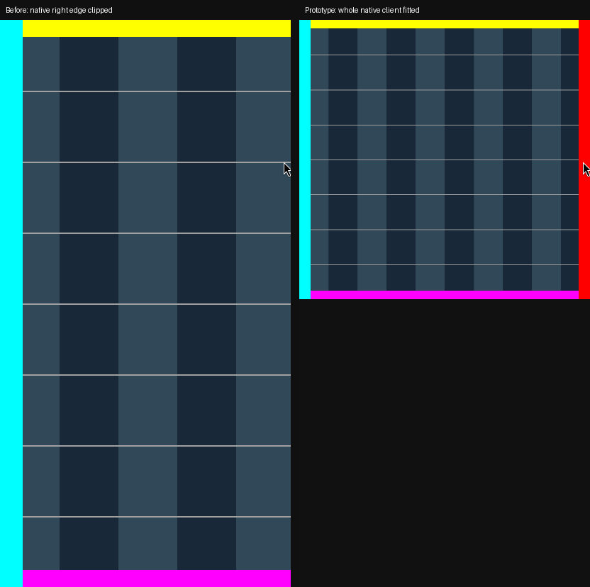

# Native oversized-window fitting prototype

## Purpose and status

Prototype a per-window accommodation for native desktop applications whose committed layout is larger than their allocated Phone/Tablet workspace. The same native applications are intended across device classes. Lowering global output scale, switching to web/mobile clients, and editing application profiles are not the proposed product solution.

This is a feasibility-gated prototype, not a shipped fix for #77. No existing general native render/input-scale API has been established. The first implementation target is an isolated compositor and a controlled oversized Wayland client, not a live user application.

## Established problem

At a 720-logical-pixel portrait allocation, native Wayland Discord rendered a wider viewport. Relaxing its native minimum through the shipped bridge and issuing a fresh configure made the viewport fit at unchanged app zoom. Ordinary tiling also reproduced the mismatch. This isolates an application-side constraint problem that a compositor minimum-hint override alone cannot resolve.

Chromium 148 has constraint clamps in both configure handling and state-request processing. Electron 42 also adds restored-frame insets to its Linux minimum; the exact original runtime minimum and insets remain unmeasured. Do not equate the startup minimum fallback, the reported client allocation, and the actual committed layout size.

Sources:

- [Chromium configure handling](https://github.com/chromium/chromium/blob/148.0.7778.280/ui/ozone/platform/wayland/host/wayland_toplevel_window.cc#L480-L558)
- [Chromium common constraint handling](https://github.com/chromium/chromium/blob/148.0.7778.280/ui/ozone/platform/wayland/host/wayland_window.cc#L1385)
- [Electron Linux minimum insets](https://github.com/electron/electron/blob/v42.11.15/shell/browser/ui/electron_desktop_window_tree_host_linux.cc#L56-L110)
- [Measured evidence and controls](https://github.com/thediamondsaint/tessarchy/issues/77#issuecomment-6314145258)

## Candidate mechanism

Investigate an opt-in, ABI-checked Hyprland extension that presents an oversized native surface at an aspect-preserving fit scale and applies the inverse transform to input. Preserve the host compositor's native protocol handling rather than interposing an incomplete desktop compositor.

Exact-version private render/UV and pointer-picking hooks have now passed a controlled native-client proof. This is not a general supported API or a complete input/surface-tree implementation. Single-contact down/motion/up mapping now passes a synthetic AQ-device-to-real-wl_touch test, including a negative motion control and unload/reload. Physical touch, calibration and multiple contacts remain unverified. Reuse compositor geometry and input facilities; do not set the X11 scale member on a native window, whose input paths do not generally use that member.

The private probe selects its fixture with an explicit caller-supplied app-id filter, not a built-in app-specific sizing rule. Production per-window selection and policy are not implemented. Ordinary windows and Desktop behavior remain unchanged by default. Do not silently enable a global rule, patch Discord, write profile data, alter app zoom, or change display scaling.

## Alternative research

- PR #61 provides workspace scrolling/window tape, not per-window layout fitting; do not relabel it as a solution to clipping inside one application.
- Gamescope has render/input downscaling but inspected upstream lacks complete native desktop protocol coverage, including an established text-input/OSK bridge. Its game-focused path is not a verified universal native desktop wrapper.
- Sommelier is a protocol-aware scaling proxy with native pointer/touch/popup transformations. Its ChromeOS-oriented protocol/build dependencies and text-input compatibility are not established for this session. It remains a research alternative, not a supported dependency.

## Acceptance gates

1. **Feasibility:** identify exact render, UV, hit-test, pointer, touch, popup and text-input cursor-rectangle paths for the pinned compositor. Abort a candidate that cannot transform all required paths safely.
2. **Controlled reproduction:** a native Wayland test client deliberately retains an oversized committed layout. Verify the right edge is absent before fitting and visible after fitting. This fixture is synthetic, not a claim about the real Discord client.
3. **Geometry:** keep aspect ratio, account for window geometry origin and output scale, preserve surface-local coordinates, avoid crop-based UVs, transform damage/opaque regions consistently, and leave letterboxing noninteractive.
4. **Input:** verify edge/corner pointer hit locations, drag/motion, scrolling and touch sequences against client-reported numerical coordinates. Unsupported paths must be explicit; do not infer touch success from mouse tests.
5. **Surface tree:** verify subsurfaces and popup positioning, grabs and repositioning. A main-surface-only proof is not product acceptance.
6. **Lifecycle:** verify window close/unmap, opt-out/unload, configuration rejection on ABI mismatch, resize, rotation, OSK work-area changes and multiple outputs. Never load an experimental extension in the user's live compositor.
7. **Real app:** only after isolated safety gates, verify a clean native application instance with no private data; do not use a personal Discord session as the test fixture. A controlled fixture alone does not close #77.

## Touch-size limitation

Fitting a fixed oversized layout into a smaller workspace also shrinks its controls. It cannot guarantee 48dp application targets. Keep shell targets density-correct and record this fallback trade-off; do not claim compositor scaling makes an unresponsive desktop layout fully mobile-adaptive. A reflow-capable client fix remains preferable.

## Dependencies and order

Independent of #82 automatic density-based output scaling. Fit operates on the workspace that the selected display policy provides; it must not change that policy to conceal application defects. Existing rotation, shell-app lifetime and OSK safety work must not regress.

## Validation and takeover

The isolated native-client proof now builds and executes against Hyprland 0.56.2 / `efb50993780079460b0cbed1363e2166a2de1d9f`. See [reproduction, safety boundaries and diagnosed pitfalls](../tests/native-fit/README.md).

Actual [execution receipt](native-window-fit-fixture-proof.json):

- Native committed layout **832×800**, compositor allocation **410×800**; proportional fit factor **0.49278846153846156**.
- Baseline right-edge red marker: **0 pixels** visible. Fitted: **6177 red pixels**, with both lateral and both vertical edge markers visible.
- Real screen click `(400,200)` reached native client `(811.707,405.855)`; independent inverse calculation is within protocol quantization tolerance.
- Five repeat captures, disable, unload, reload, a second fitted click and second unload passed. Disable/unload restored baseline pixels exactly, and the original client remained alive.
- The test compositor's parent remained alive. No live ASUS compositor, personal app instance, app profile, zoom or display policy was modified.

Additional [single-contact execution receipt](native-window-fit-touch-proof.json) verifies the normal compositor touch pipeline using a compositor-local synthetic AQ source, not a physical/kernel input device. Corrected motion, a deliberately uncorrected RED control, disabled fitting, active-contact unload and reload all pass.

Letterboxed padding now passes new pointer/touch rejection checks with positive content-event barriers. The [captured RED observation](native-window-fit-letterbox-red.json) showed both input types reaching the app before the outer-window selection fix; the updated touch receipt shows no padding input. This is not yet a general popup/overlapping-window selection policy.

This is **not** #77 product acceptance. Physical/multicontact touch and cancellation, pointer drag/scroll/grabs, popup/subsurface trees, nonzero geometry origins, rotation/fractional scaling, OSK/IME cursor rectangles, incremental damage/occlusion, general overlapping-window/popup selection, real native applications and device use remain unverified. The plugin is deliberately absent from session/image/package integration.
