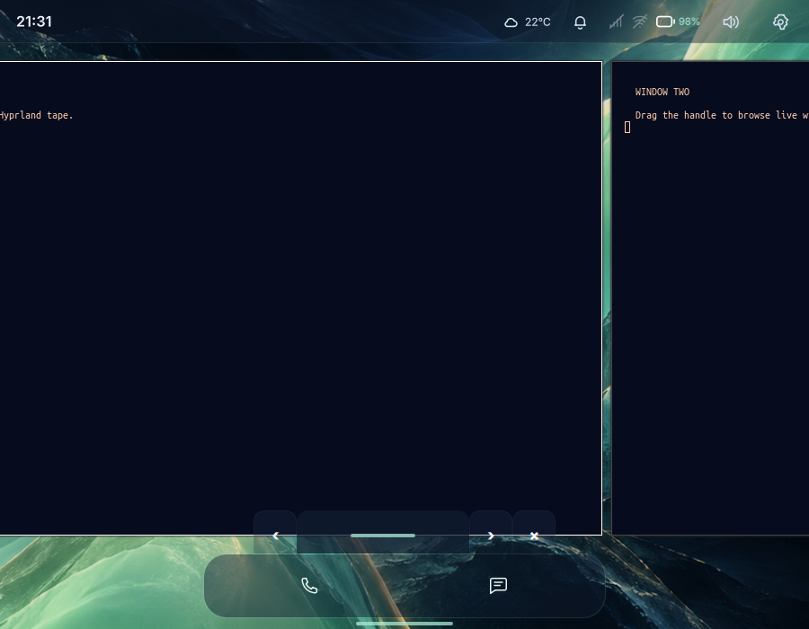

# Proposal: touch-controlled window tape

Status: opt-in prototype on PR #61; pilot acceptance remains pending. Research date: 2026-10-20.
Repository baseline: `e52ff9e` (main).

## Recommendation

Give Tessarchy a horizontal strip of real application windows, navigated by a
finger-operated, auto-hiding control above the bottom navigation. Prototype this
on Hyprland's built-in scrolling layout first. Make it an opt-in Window Tape mode
for phone/tablet evaluation; promote it to the default after physical-device
acceptance. Keep Desktop's existing windowed/tiling choices during the pilot.

Hyprland stays: this is the owner’s explicit constraint. Niri is an interaction
reference only. The migration comparison below explains the additional work; it
is not a proposed implementation path.

## Implemented prototype

Open **Settings → Try Window Tape**, or press **Super+T**, then launch apps.
Only the named `tessarchy-tape` workspace uses scrolling. Ordinary phone/tablet
maximization and desktop floating rules skip its tiled windows. Existing apps
stay in their original workspaces; this release does not migrate them.

Tap **Window tape** to reveal the drag strip, previous/next buttons and an exit
button. Drag horizontally to browse. The expanded strip hides after 1.5 seconds
of inactivity and stays open under a held finger. Targets are at least 48 logical
pixels, and the surface never takes keyboard focus. Super+[ and Super+] navigate
columns. Exit returns to the preceding workspace, or workspace 1 if it is gone.

The first version uses full-width columns in all modes. Tablet half-width sizing,
proportional scrollbar telemetry and promotion to the default remain future work.

### Reuse and the optional native bridge

The layout, geometry, focus selection and snapping come from Hyprland. Tessa
reuses TouchButton, GestureHandle, its theme and Qt's existing mouse/touch delivery.
There is no new tiling engine, compositor fork or window screenshot carousel.

Runtime inspection found that the public `move` layout message refocuses a
window after each update. That hard focus fits the column back into view, so
small drag increments cannot produce continuous motion. The optional 48-line
C++ bridge calls the existing `CScrollingAlgorithm::moveTape`,
`snapToProjectedOffset` and `focusColumn` methods used by native gestures.
It registers two Lua callbacks through the public plugin API and keeps no
window pointers or persistent compositor state. It checks the native plugin ABI
hash before loading. Source:
[Hyprland 0.56.2 scrolling implementation](https://github.com/hyprwm/Hyprland/blob/v0.56.2/src/layout/algorithm/tiled/scrolling/ScrollingAlgorithm.cpp).

Without the bridge, dragging accumulates 120 logical pixels before using native
previous/next column navigation. This is a discrete fallback, not continuous
panning. The same buttons and shortcuts work in either case. Lua validates the
active workspace/output, finite numeric input and content edges; QML coalesces
movement at 16 ms intervals over Quickshell's existing compositor IPC connection.
`follow_focus=false` prevents compositor mouse release from snapping back to the
original app before Tessa settles; explicit click/key focus still follows.

### Try continuous panning in a Tessarchy guest

With matching Hyprland 0.56.2 headers, compiler, Lua headers and pkg-config
dependencies already installed, build from this branch:

```sh
./scripts/build-window-tape.sh
```

After a development install, place `dist/tessarchy-tape-0.56.2.so` at
`$XDG_DATA_HOME/tessarchy/plugins/tessarchy-tape.so`, or
`$HOME/.local/share/tessarchy/plugins/tessarchy-tape.so` when XDG_DATA_HOME is
unset. Reload the **guest's Tessarchy** configuration. The optional library is
loaded from the session's data directory. Packaged sessions use
`/usr/share/tessarchy/plugins/tessarchy-tape.so`. Do not replace a loaded library;
unload it before replacing it. Rebuild against matching headers after a compositor
upgrade. Neither the build script nor these changes installs dependencies, and
the binary is not bundled in the ISO or committed.

The strip respects the compositor's reserved panel area rather than reserving
more application space. OSK interaction, physical touch latency, rotation and
multi-output acceptance are still pending. The current evidence is an isolated
nested compositor, not the target VM or physical tablet.



Actual capture: nested Hyprland 0.56.2, 900×700, scale 1, two live Foot windows,
Tessa and the native bridge. A Wayland virtual pointer exercised the drag.

## Research findings

Hyprland already provides a scrolling layout with pixel-relative movement,
column sizing and fit operations. Workspace rules can select that layout.
These are sufficient primitives for a shell-controlled tape experiment, although
the exact installed 0.56 API and drag responsiveness still require a guest spike.
Sources: [scrolling layout](https://wiki.hypr.land/Configuring/Layouts/Scrolling-Layout/),
[versioned Lua-era reference](https://wiki.hypr.land/0.55.0/Configuring/Layouts/Scrolling-Layout/),
[workspace rules](https://wiki.hypr.land/0.55.0/Configuring/Basics/Workspace-Rules/).

Niri distinguishes touchpad gestures from touchscreen interaction. Its documented
touchscreen tiled-window drag scrolls the view while Mod is held. Its overview
supports one-finger scrolling and long-press window movement. This supports the
interaction direction, but does not establish that stock Niri supplies the
requested auto-hiding slider or a modifier-free normal-view touch gesture.
Sources: [Niri gestures](https://github.com/niri-wm/niri/blob/main/docs/wiki/Gestures.md),
[Niri overview](https://github.com/niri-wm/niri/blob/main/docs/wiki/Overview.md).

Niri has JSON requests, actions and a state event stream for shell integration.
That is a viable integration foundation, not a drop-in replacement for Tessa's
current Hyprland models and dispatch calls. Verify continuous external panning
and viewport telemetry before choosing Niri for a custom slider.
Source: [Niri IPC definitions](https://github.com/niri-wm/niri/blob/main/niri-ipc/src/lib.rs).

Upstream main and unversioned documentation can describe unreleased features.
Pin the installed package version and API during the spike; do not depend on
newer fullscreen or scroll-inhibition features merely because current docs list them.

## Proposed interaction

The tape holds live windows in stable spatial order, independently of Recents'
most-recently-used ordering. Horizontal movement stays within the current
workspace and output. Existing workspace controls remain a separate action.

- Phone: start with one column approximately the usable screen width. Evaluate
  a small neighbor peek only where application minimum widths allow it.
- Tablet: start with two roughly half-width columns, with full-width available.
- New ordinary apps join next to the active column and are brought into view.
  Dialogs remain floating and parent-associated; transient windows do not become
  independent tape columns.
- A short mint pill sits above navigation. Its visual mark may be small, but its
  complete touch target is at least 48 by 48 logical pixels. Tap reveals an
  expanded 48-pixel-high scrub strip; dragging it pans the live tape immediately.
- Initially use relative scrubbing: finger displacement moves the tape in the
  same direction, with a tunable logical-pixel gain. Release fits the nearest
  suitable column. Avoid momentum in the first implementation.
- The expanded strip hides after an initial 1.5-second idle delay. Keep it visible
  during a drag, keyboard navigation, pointer interaction or accessibility focus.
  The reveal pill remains discoverable; settings offer an always-visible strip.
- Previous/next buttons and keyboard actions provide equivalent navigation.
  Reduced motion disables optional settling animation.
- With no windows hide the scrubber; with one window disable panning. Do not
  wrap at tape ends. Fullscreen apps retain an explicit navigation/reveal path.
- Put the strip above the OSK when shown. Opening it must preserve the text field's
  keyboard focus. Reserve a stable navigation area so auto-hide cannot repeatedly
  resize applications. Use input regions so invisible overlay area cannot steal
  touches from apps.

This intentionally starts with a relative drag control rather than a scrollbar
that promises an exact position across every window. A proportional thumb needs
reliable total tape bounds and viewport offset; those have not been verified.
If users need long-distance jumps, add a spatial app strip/overview after the
basic drag works. Swiping inside app content continues to belong to the app.

## Implementation shape and current conflicts

`session/hyprland.lua` currently selects dwindle, floats/resizes tagged phone
windows, maximizes tablet windows, and floats desktop apps by default. Those
rules would prevent ordinary mobile windows from joining a visible tape. Gate
those paths behind the new mode; treat conversion of already-open windows as
an explicit migration with saved geometry/state and a reversible fallback.
Do not apply a global scrolling layout change to unrelated desktop workspaces.

`shell/shell.qml` directly imports Quickshell.Hyprland and uses its toplevels,
workspaces, focused monitor and dispatch calls. Add a small tape controller at
that boundary and a reusable `WindowTapeControl.qml`. Keep spatial tape state
separate from existing `windowHistory` and switcher policy. Use existing Theme
and focus-preserving navigation patterns.

Define controller operations for begin-drag, relative movement, end-drag,
previous/next, cancel and availability. Resolve and validate the target output
and workspace on begin; cancel if either disappears or changes. Scope dispatches
to that target, and fail closed if the installed API cannot do so reliably.
Coalesce input updates and serialize bounded numeric movement commands; do not
spawn a process per touch event or insert app titles into commands. Measure
whether compositor animation/focus-follow causes lag or jumps during dragging.

On release select the visible destination deliberately and fit it without a
focus-follow snap back. Confirm that the installed API supplies enough geometry
for this policy. If it does not, retain relative motion with explicit next/previous
until the telemetry problem is resolved. App close, modal dialogs and rotation
must cancel stale drags safely and retain a reachable active window.

Niri migration would additionally touch `start-tessarchy`, the session desktop
entry, services/idle/OSK, rotation and screenshots, window-controls/Hyprbars,
Quickshell window/workspace adapters, previews, package recipes, ISO contents,
portals and greeter startup. Check protocol support and X11 application handling
in the pinned Niri release. A migration requires a separate compatibility matrix
and cannot inherit Hyprland VM acceptance.

## Difficulty and estimated effort

Engineering estimates below assume one developer familiar with this repository,
existing guest tooling and access to a real touchscreen. These are person-days,
not measured implementation times. Allow roughly 30–50% contingency until the
first spike resolves API, input and frame pacing uncertainty.

| Scope | Difficulty | Effort | Deliverable |
| --- | --- | --- | --- |
| Hyprland feasibility spike | Moderate, 4/10 | 1–2 days | Live tape moved from a touch surface; version/API and latency evidence |
| Opt-in usable prototype | Moderate, 6/10 | 4–7 additional days | Mode policy, relative scrubber, focus, fallback and automated checks |
| Pilot-ready behavior | Hard, 7/10 | 5–10 additional days | Rotation/OSK/fullscreen/dialog/output cases and physical-touch tuning |
| Hypothetical Niri migration | Very hard, 9/10 | 20–40 days total | Session/backend port and compatibility/packaging/device acceptance |

Budget 10–19 person-days total for a Hyprland pilot, or approximately 2–4 working
weeks before contingency. A visible demo is much easier than reliable daily use.
An accurate proportional scrollbar is extra investigation, not included as a
promised capability. Kernel, modem and new-device bring-up are outside these estimates.

## Delivery gates

1. **Spike:** isolated guest workspace, pinned Hyprland version, at least three
   live apps, one-finger shell drag and measured command/frame behavior. Confirm
   direction, bounds, workspace targeting, focus and fit semantics. If movement
   cannot track touch acceptably, investigate a Hyprland extension or narrow the
   first release to column stepping before committing to continuous scrubbing.
2. **Prototype:** opt-in policy and visible navigation fallback, reusable control,
   no app-content gesture interception, reversible mode transition. Resolve
   overlap with the open tablet-split PR #12 rather than stacking both policies.
3. **Pilot:** complete the matrix below, collect physical-tablet feedback, then
   decide defaults. Resolve blockers within Hyprland; compositor migration is out
   of scope.

## Acceptance and validation

Automate state transitions for reveal/hide, drag/cancel, empty/single/multiple
windows, numeric movement bounds and disappeared workspace/output. Check that
spatial ordering survives focus-history changes. Run `./scripts/check.sh` and
record actual evidence in `docs/testing.md` for each implementation PR.

Manual guest and physical-device acceptance must cover:

- Three to ten actual apps; continuous movement under a finger, no queued motion
  after release, no tape wrap and no focus jumping back to the starting app.
- Browser horizontal scrolling, text selection and app swipes still work outside
  the control. Hidden overlay areas pass input through.
- OSK appearing/disappearing while editing; text focus and cursor remain stable.
- Portrait/landscape rotation, fractional scale and Phone/Tablet/Desktop changes.
- Modal dialogs, fullscreen/video, app close/crash, long app minimum widths,
  multiple outputs, workspace switching and unplugging an output mid-drag.
- Touch-only discovery, mouse/keyboard equivalents, reduced motion and at least
  48-pixel targets. Capture actual interaction video and the tested source SHA.

Source inspection, automated tests and nested-compositor prototype results are
recorded in [testing.md](testing.md). Physical-device acceptance and the remaining
pilot matrix are pending. The original estimates above describe the full pilot.
